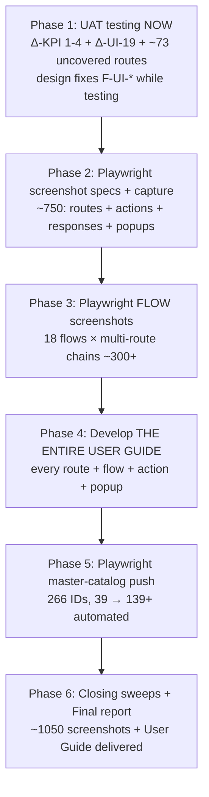

# GoRetailOS — Full-Product User Manual Plan (UAT + Playwright + Screenshots)

> **Mission:** capture **every route, every flow, every feature** of the application as real
> screenshots, and develop **the entire product User Guide** — each and every flow and feature
> documented — driven by UAT testing, Playwright automation, and UI design-fixation review.
>
> **Status: PLAN READY — UAT FIRST (owner 2026-10-04).** **NEW order: 1️⃣ UAT testing NOW
> (Custom KPI Engine + UI conformance Δ 2026-10-04 + ~73 uncovered routes) → 2️⃣ FIX design issues
> (found while testing, F-UI-* prefix) → 3️⃣ Capture screenshots (~1050: routes + actions +
> responses + 18 flows + popups — Playwright drives EVERY capture) → 4️⃣ Document in User Manual →
> 5️⃣ Playwright master-catalog push.** **KPI screens UAT-blocked until migration applies** (see §3
> Phase 4 note). Phases re-sequenced §3.
>
> **Prepared:** 2026-10-04 · Source of truth: docs reviewed 2026-10-04 (newest file wins)

---

## 0. Expert readiness (what this run fixes first)

Four expert areas are loaded and ready **before** any step starts:

| # | Expert area | Ready means | Evidence already loaded |
|---|---|---|---|
| 1 | **UI design fixation** | Every screen reviewed against [SHARED_OS_UI_DESIGN_SYSTEM.md](../../SHARED_OS_UI_DESIGN_SYSTEM.md) (787 lines: Tailwind v4, oklch tokens, Inter/Space Grotesk/JetBrains Mono, heading system, radius, spacing, dark mode) — drift recorded, fixes queued | Design system read; 18 screenshots reviewed 1440×900; alignment docs: build-green, runtime visual **NOT** done (this run does it) |
| 2 | **UAT testing** | Route-by-route row discipline: ✅ PASS · ❌→✅ FIXED · ⚠️ ENV · ⏭ N/A — every action's impacts verified (LIST/DET/KPI/RT/NOTIF/AUD/LEDGER/STOCK/STORE/POS/PORTAL/AI/CSV/PDF) | [GORETAILOS_LOVABLE_FULL_UAT.md](GORETAILOS_LOVABLE_FULL_UAT.md) 76 rows closed read; §K automation-ceiling checklist ready; ~73 routes still uncovered |
| 3 | **Working with Playwright** | 28 existing specs + 4 helpers + auth.setup; 6 QA issues resolved (lessons learned); **motion-buttons FIXED** (`dispatchEvent(new MouseEvent('click',{bubbles:true}))`); **SearchSelect still harness-blocked** (use upstream array or by-NAME dept dropdown) | [TEST_CASES.md](TEST_CASES.md) 266 IDs read; [PLAYWRIGHT_QA_ISSUES.md](PLAYWRIGHT_QA_ISSUES.md) 6/6 resolved; helpers: `qa.helpers.ts`, `admin.helpers.ts`, `pos.helpers.ts`, `storefront.helpers.ts` |
| 4 | **Capture screenshot → User Manual** | Every screenshot → `docs/screenshots/<domain>/<name>.png` (1440×900) → inserted into the manual with field-level + flow-level docs; 18 captured, 39 refs, 0 broken — expanding to **149 routes** | [DOC_SCREENSHOT_REVIEW.md](DOC_SCREENSHOT_REVIEW.md) 18/18 ✅ read; [USER_MANUAL.md](../manuals/USER_MANUAL.md) 15 sections + 2 appendices read; capture script `tests/e2e/docs-screenshots.spec.ts` ready |

---

## 1. Route inventory (149 total — the manual covers EVERY one)

**110 authenticated/admin routes** (`src/routes/_authenticated/`): admin.index (Dashboard), pos,
products, orders, sales, sales-reports, purchasing, purchasing-reports, accounting, inventory,
inventory-reports, customers, segments, crm, crm-analytics, customer-groups, loyalty, campaigns,
promotions, promotions-adjacent reviews, brands, categories, attributes, tax, suppliers, registers,
transfers, stock-counts, labels, import, sync, storefront, ai, team, audit, settings, data-manager,
modules, subscription, integrations, emails, domain-setup, domain-adjacent social, uat-data, tours,
bi, bi.reports, finance, budgets, payables, receivables, payments, expenses, expense-categories,
accounts, employees, departments, designations, attendance, leave, loans, loans-adjacent performance,
payroll, hr.payroll-ops, hr.compliance, hr.lifecycle (index + $id), hr.workforce-requests,
recruitment, manufacturing, restaurant (index + $section + 12 sub: pos/kds/floor-plan/reservations/
waitlist/delivery/fulfillment/refunds/wastage/analytics/food-cost/restaurant-site),
procurement (index + 12 sub: requisitions index+$id, rfqs index+$id, quotations index+$id,
comparisons, approvals, awards index+$id, contracts index+$id, reports, settings, suppliers
index+$id), reports, my, onboarding, platform, route.tsx (shell).
**Plus 39 public routes**: auth, reset-password, index (landing), docs.$docId, invite.$token,
vendor.invite.$token, vendor.rfq, order.$token, r.$token (receipt), pos-display, offline-pos,
manual, pos-manual, labels-manual, usage, store.$shopSlug (31 sub: index, shop, product.$slug,
category.$slug, cart, checkout, compare, wishlist, account, sign-in, sign-up, forgot-password,
track-order, about, contact, page.$slug, flash-deals, payment.cancel, payment.success, vendor,
**dine, dine.p.$pageSlug** — the new restaurant website!).

**UAT ledger coverage today:** ~76 rows closed → **~73 routes never screenshotted/documented** —
this run closes EVERY one.

---

## 2. ⛔ LIVE-PRODUCTION SAFETY (read before anything else)

GoRetailOS has **real, paying, grandfathered-lifetime customer organizations**. Absolute rules
(from [GORETAILOS_LOVABLE_FULL_UAT.md](GORETAILOS_LOVABLE_FULL_UAT.md) §LIVE-PRODUCTION SAFETY —
still binding):

1. **Create a brand-NEW org for this run** (or reuse **Al Manar Trading (UAT Demo)** /
   `al-manar-trading-uat-demo` + **ZZ-UAT Trial Shop**) and do ALL testing inside it.
   **Never reuse, enter, or operate inside any pre-existing org — Trendies untouched.**
2. **Zero writes to live organizations. Zero.** The ONLY live-org contact allowed: single VIEW-ONLY
   check (scroll and read — click no buttons) — or skip it, mark ⏭ N/A.
3. **Never grant/extend/revoke/override a license** on any org except UAT org + ZZ trial shop.
   Grandfathered LIFETIME rows are commercially binding.
4. `LICENSING_ENFORCED` stays **OFF** in production. Flip only in preview/staging, restore after
   (sweep X-10 checks).
5. The offline POS queue is sacred: never clear another shop's localStorage/IndexedDB.
6. **If a test row would require touching an org you did not create, STOP — mark ⏭ N/A.**

**Login:** `voxiralabs@gmail.com` / password owner fills before run; **ROTATE after** (written in
[UAT ledger](GORETAILOS_LOVABLE_FULL_UAT.md)). **Manual/live-verification owner (TEST_CASES.md):**
`sarimulhaq74@gmail.com` / `19972015AH` (owner of `trendies-store`) — do not commit to repo.

---

## 3. Master run phases (RE-SEQUENCED 2026-10-04 — design FIRST, UAT later)

> **Owner 2026-10-04:** "For now the priority would be fixing any design issue first and then
> capture the screenshot and document in the user manual, UAT testing will be done later."
> **New order:** Phase 1 UI-fixation sweep (drift → **FIX IMMEDIATELY**) → Phase 2 screenshots →
> Phase 3 User Manual → Phase 4 UAT (LATER) → Phase 5 Playwright (LATER) → Phase 6 closing.

## 3. Master run phases (RE-SEQUENCED 2026-10-04 — UAT FIRST, KPI screens ready-to-test)

> **Owner 2026-10-04: "Can we first proceed with UAT testing of this?"** — **YES: UAT NOW.**
> **NEW handoff [HANDOFF_2026-10-04_CUSTOM_KPI_AND_UI_CONFORMANCE.md](C:/Users/haqs/HANDOFF_2026-10-04_CUSTOM_KPI_AND_UI_CONFORMANCE.md):
> Custom KPI Engine COMPLETE (both products, gates green, UNPUBLISHED) + admin-wide table/tile
> conformance COMPLETE — ALL publish-gated.** UAT tests: Δ-KPI-1..4 + Δ-UI-19 rows + ~73 uncovered
> routes FIRST → design fixes while testing → screenshots → manual → Playwright push.
> **KPI screens (`/admin/kpis`) show graceful empty/error states until migration
> `20261009121000_custom_kpi_engine.sql` applies with the owner deploy — UAT rows ⚠️ ENV or
> test-after-publish (canary: `/admin/kpis` loads without error states).**

### Phase 1 — UAT testing NOW (Δ-KPI + Δ-UI-19 + ~73 uncovered routes FIRST)
Run [GORETAILOS_LOVABLE_FULL_UAT.md](GORETAILOS_LOVABLE_FULL_UAT.md) sections A–K row-by-row +
**NEW Δ 2026-10-04 rows FIRST**: Δ-KPI-1..4 Custom KPI Engine (create KPI → tile appears on
dashboard → click → drill table → Save view — `/admin/kpis` premium studio: rail Mine/Org/Platform,
FieldPathPicker multi-hop ≤3, typed operators, live debounced count preview, scope gating by
`canManage`; dashboard `ckpi:<uuid>` widgets; `/admin/kpis/$kpiId` drill: locked stored-condition
chips vs removable session filters, column manager root+belongs-to ≤40, root-only sort, server
pagination 25/50/100, per-user Save view/Reset; module strips: restaurant overview / growth
(marketing) / procurement index; sidebar "Custom KPIs" entry; PlatformConsole "Custom KPIs" section
+ OrgMultiPicker — **migration ⚠️ ENV until owner deploy, test-after-publish canary**) · Δ-UI-19
admin-wide conformance (Pagination unified, search+pager added: manufacturing BOM, campaigns,
promotions+coupons, designations, departments; thead ×11; raw colors → tokens; hand-rolled tiles
ZERO) · **~73 uncovered routes**: §A vendor-portal supplier submission (prompt() harness limit —
invite is Active; use `dispatchEvent` fix) + customer account incognito rows + `/r/$token`
happy-path (window.print freezes harness) · §D2b **Restaurant website** rows (NEW per-shop customer
site `/store/<slug>/dine` + `/admin/restaurant-site` editor + Domains "Serves" selector) ·
§F-LIC licensing ledger rows deferred (staging-only `[ENF]` F-LIC-9/16 + F-LIC-7 expiry-sweep SQL
+ F-LIC-1 grandfather read-only SQL count) · sitewide SEO hardening rows.
- **Row discipline:** ✅ PASS · ❌→✅ FIXED (fill Why + Fix, append Fix Log §H) · ⚠️ ENV · ⏭ N/A.
- **Impact codes:** LIST · DET · KPI · RT · NOTIF · AUD · LEDGER · STOCK · STORE · POS · PORTAL ·
  AI · CSV · PDF (write only ones verified).
- **Fix while testing** (F-* prefix): F-POS-TAX-1 style — root cause + change + re-run proof.
  **Design issues found → FIXED IMMEDIATELY (F-UI-* prefix)** — owner priority 2026-10-04.
- **Demo-data mandate (§0.5):** every create action seeds Al Manar Trading (UAT Demo) — approaching
  25+ product target; current: 7 products + 1 BOM + full POS/restaurant/procurement/CRM/HR seed.
- **NEW traps (handoff §7):** `var(--color-x)` in GR style attrs/SVG resolves against stock :root
  tokens (orange-chart bug) — use raw `var(--x)` · dashboard merge trap §29.2 (dynamic widget ids)
  · `admin.accounting.tsx` is CRLF — single-line anchors · GR tsconfig `noUncheckedIndexedAccess`
  + `exactOptionalPropertyTypes` · live-site screenshots from owner are usually OLD build — check
  locally before treating as regression.
- **Output:** Δ-KPI/Δ-UI rows closed + ~73 routes closed + design fixes F-UI-* + Fix Log §H updated.

### Phase 2 — Playwright screenshot specs + capture (~750 shots — drives EVERYTHING)
**Playwright drives EVERYTHING in this phase** (owner 2026-10-04: "Capturing screenshots would
require playwright I think" — CONFIRMED, specs + config run FIRST): extend
[docs-screenshots.spec.ts](../../../tests/e2e/docs-screenshots.spec.ts) 18 tests + `playwright.screenshots.config.ts`
with ~730 new screenshot steps (149 routes + ~600 action/response + popups) BEFORE any capture;
drive every **admin** route (110) + **public** route (39) at 1440×900 via Playwright, review EACH
against the design system (typography → heading system → radius → spacing → colors → dark mode →
`num` tabular-nums → motion-animated buttons), **FIX every drift issue IMMEDIATELY** (F-UI-*
prefix), re-verify fix (`tsc --noEmit` 0 errors + vitest pass), re-run Playwright capture
for the fixed route — **NOT only the route: EVERY action + how it responds**: click each action
available on the route → screenshot BEFORE → capture response (list row appears/updates, detail
page, KPI strip, modal/dialog opens, toast/inline message, drawer, tab switch) → screenshot AFTER →
record both into `docs/screenshots/<domain>/<name>.png`.
- **POS sale flow:** products list → POS terminal → scan/add item → cart → register select →
  cash-session open → payment → receipt (`/r/$token`) → orders list → return → refund — ~12 routes.
- **Offline sync flow:** POS offline → sync console → conflict resolve → POS session bar — 4 routes.
- **Product → inventory flow:** product create (form + fields + popup) → variant → barcodes →
  prices → costs → images → inventory balance → stock movement — ~8 routes.
- **Transfer flow:** transfers list → create → items → locations → receipt — 4 routes.
- **Stock count flow:** stock-counts list → create → items → adjust → approval → GL journal — 5 routes.
- **Purchasing flow:** suppliers list → supplier create → PO create → PO items → goods receipt →
  receipt items → supplier invoice → supplier payment — ~8 routes.
- **Accounting flow:** accounts tree → journal entry → lines → expense → category → payment
  methods → bank accounts — ~7 routes.
- **Storefront cart → checkout flow:** store home → product detail → add to cart → cart → checkout
  (guest/signed-in) → payment.cancel → payment.success → track-order — ~8 routes.
- **Customer account flow:** sign-in → account → addresses → wishlist → order history — 5 routes.
- **Restaurant dine-in flow:** restaurant POS → floor/tables → KDS → settle (split/single) →
  reservations → waitlist → delivery → fulfillment → refund → **restaurant website** (`/store/<slug>/dine`)
  → `/admin/restaurant-site` editor — ~12 routes.
- **CRM → loyalty flow:** CRM segment → campaigns → promotions → coupon → loyalty earn → redeem →
  reviews — ~7 routes.
- **HR → payroll flow:** employee create → departments → attendance → leave → loans → performance →
  payroll run → post → payroll-ops → compliance → lifecycle → workforce-requests → recruitment — ~13 routes.
- **Procurement flow:** requisition create → RFQ → quotation → comparison → approval → award →
  contract → supplier → vendor-portal (`/vendor/invite/$token`, `/vendor/rfq`) — ~10 routes.
- **AI assistant flow:** AI workspace → permissions → knowledge documents → chunks → conversations
  → messages → tool calls → action approvals → alerts — ~9 routes.
- **Manufacturing flow:** BOM create → costing → production — 3 routes.
- **Finance flow:** budgets → payables → receivables → payments — 4 routes.
- **Auth + onboarding flow:** landing → sign-in → onboarding → admin (or `/auth` → `/admin`) — 4 routes.
- **Invite flows:** team invite (`/invite/$token`) + vendor invite (`/vendor/invite/$token`) +
  vendor RFQ (`/vendor/rfq`) — 3 routes.
- **Popups in flows:** EVERY modal/dialog/prompt inside each flow step — screenshot OPEN + actions
  + response (confirm dialogs, form popups, SearchSelect, EntitySelect, prompt() limit).
- **Output:** ~18 flows × ~8 routes avg = **~144 flow-route chains, ~300+ flow screenshots**,
  every popup + action + response documented. Update [DOC_SCREENSHOT_REVIEW.md](DOC_SCREENSHOT_REVIEW.md).

### Phase 3 — Develop THE ENTIRE USER GUIDE (every route, every flow, every action, every popup)
Expand [USER_MANUAL.md](../manuals/USER_MANUAL.md) (179KB, 15 sections + 2 appendices) +
[usage.md](../manuals/usage.md) (37KB flows & setup) + [POS_MANUAL.md](../manuals/POS_MANUAL.md) +
[LABELS_MANUAL.md](../manuals/LABELS_MANUAL.md) with **every route, every flow, every action,
every popup — how it responds**, inserting Phase 1 + 2 screenshots (~750 + ~300 = ~1050):
- **Per route (149):** screenshot (Phase 1) + Purpose / Access / Backend (server function + tables)
  + Fields table (UI label · Field key · Type · Req ●/○/auto · Default · Validation · Notes) +
  Connections (selects/references · feeds/used by · cross-form effects: stock movements, ledger
  postings, sequence numbers).
- **Per route (149):** screenshot (Phase 1) + **EVERY action + how it responds** (Phase 1: click
  each action → screenshot BEFORE → response → screenshot AFTER) + Purpose / Access / Backend
  (server function + tables) + Fields table (UI label · Field key · Type · Req ●/○/auto · Default ·
  Validation · Notes) + Connections (selects/references · feeds/used by · cross-form effects: stock
  movements, ledger postings, sequence numbers).
- **Per flow (every one — 18 flows, multiple routes each):** screenshot chain (Phase 2) + step-by-step
  guide: POS sale → return → refund → receipt (12 routes) · offline sync (4) · product → variant →
  barcodes → prices → costs → images → inventory (8) · transfer → locations (4) · stock count →
  adjust → approval → GL journal (5) · supplier → PO → goods receipt → invoice → payment (8) ·
  accounts tree → journal entry → lines → expense (7) · cart → checkout (guest/signed-in) →
  payment.cancel/success → track-order (8) · customer sign-in → account → addresses → wishlist (5) ·
  restaurant dine-in → KDS → settle → **website** (12) · CRM → loyalty earn/redeem (7) · HR →
  payroll run → post → lifecycle (13) · procurement requisition → RFQ → award → contract →
  vendor-portal (10) · AI assistant → permissions → knowledge → conversations → approvals (9) ·
  manufacturing BOM → costing → production (3) · finance budgets → payables → receivables (4) ·
  auth + onboarding (4) · invite + vendor invite + vendor RFQ (3).
- **Per popup (every modal/dialog/drawer/confirm/prompt):** screenshot OPEN (Phase 1/2) + each
  action inside it (confirm/cancel, form fields, submit) + response after (dialog closes, row
  updates) — POS cash-close dialog, register select dropdown, SearchSelect picker, EntitySelect,
  confirm dialogs, prompt() harness limit — **all documented**.
- **Field-level convention:** `_id` = pointer to another form's record; name human form + pointer
  together (e.g. "Category" + `category_id`). `shop_id` (and often `branch_id`) = implicit auto
  field on every form — set from session/active shop, never typed.
- **Screenshots:** insert Phase 1 (~750) + Phase 2 (~300) captures into the manual — 18 captured →
  ~1050 total; update [DOC_SCREENSHOT_REVIEW.md](DOC_SCREENSHOT_REVIEW.md) inventory + refs
  (39 → ~1050).
- **Manuals are imported by code `?raw`** — `src/routes/{manual,pos-manual,labels-manual,usage}.tsx`
  — **never move/rename the manuals folder** (update routes if moved).
- **New sections to add:** Restaurant website (`/store/<slug>/dine` + `/admin/restaurant-site`) ·
  Platform console (`/platform`) + licensing · BI Reports Center (26 authoritative reports) ·
  Advanced Procurement (12 sub-routes) · Manufacturing (BOM & costing) · HR & Payroll full lifecycle ·
  CRM, Segments & Analytics · Business Intelligence · Quick Tours (`/admin/tours`) cross-ref ·
  **NEW: Flows (step-by-step with screenshots)** — 18 flows, every route + action + response +
  popup documented · **NEW: Actions & Responses (per route)** — every action, how it responds ·
  **NEW: Popups & Dialogs (per route)** — every modal/dialog, OPEN + actions + response.
- **Output:** USER_MANUAL.md 15 → 20+ sections, every form + flow + action + popup documented,
  ~1050 screenshots inserted, 0 broken refs.

### Phase 4 — Playwright master-catalog push (266 IDs → automate the ~140 unimplemented)
**Screenshot specs already running (Phase 1 & 2) — this phase adds the master-catalog TEST push**
(266 IDs, ~140 unimplemented). Read [TEST_CASES.md](TEST_CASES.md) entire (266 IDs, 20 sections:
AUTH 10 · ONBOARD 4 · TENANT 18 · RBAC 21 · DASH · Product/Catalog · POS P0 very detailed · Offline
POS · Returns/Refunds/Exchanges · Customers/CRM · Inventory · Purchasing · Sales/Orders ·
Accounting/Finance · Expenses · Storefront Admin · Public Storefront · Ecommerce Checkout · Payment
Proof P0). Current: **39 automated passed / 0 failed / 1 skipped** (~21.7% of catalog). Implement
next 100: every ID with `Suitable for Playwright? Yes` + concrete selectors + preconditions +
expected backend/results + negative assertions + cleanup. **Do not renumber IDs. Use `QA-` prefix**
for test-created records.
- **Existing specs to extend:** owner-auth, owner-smoke, owner-pos-financial, owner-rbac,
  owner-tenant, admin-dashboard-widgets, admin-forms, admin-tabs, admin-theme, admin-topbar,
  admin-ui, pos-behaviour, pos-responsive, visitor-auth, visitor-manuals, visitor-storefront-account,
  visitor-storefront-cart, visitor-storefront-security, visitor-storefront-seo,
  storefront-responsive, storefront-trexa-landing (+ pos.helpers, storefront.helpers, qa.helpers,
  admin.helpers, auth.setup).
- **Harness rules:** motion-buttons → `dispatchEvent(new MouseEvent('click',{bubbles:true}))` on the
  button node (React 19 root-delegated onClick) · SearchSelect → filters **static options array**
  client-side, empty picker = **empty upstream array** — seed upstream or use by-NAME dropdown ·
  `/auth` is server-rendered, form clickable before React attaches — retry submit until navigation
  or error (see auth.setup.ts) · `/admin/pos` has no `<main>` — wait for scan field
  `getByPlaceholder(/Scan barcode/i)` · strict mode → `exact: true` on actual rendered heading ·
  storefront responsive dual layouts → target visible layout for viewport (1440px = desktop table).
- **RBAC rows (21)** need separate-persona accounts: `E2E_ADMIN_EMAIL`, `E2E_MANAGER_EMAIL`,
  `E2E_CASHIER_EMAIL`, `E2E_ACCOUNTANT_EMAIL`, `E2E_INVENTORY_EMAIL`, `E2E_STAFF_EMAIL`,
  `E2E_CUSTOMER_EMAIL` (env vars, never committed) — create in UAT org first (Phase 4).
- **Output:** master catalog pass rate 39 → 139+ (~52%+), 0 failed, updated execution ledger in
  [TEST_CASES.md](TEST_CASES.md) merged section.

- **RBAC rows (21)** need separate-persona accounts: `E2E_ADMIN_EMAIL`, `E2E_MANAGER_EMAIL`,
  `E2E_CASHIER_EMAIL`, `E2E_ACCOUNTANT_EMAIL`, `E2E_INVENTORY_EMAIL`, `E2E_STAFF_EMAIL`,
  `E2E_CUSTOMER_EMAIL` (env vars, never committed) — create in UAT org first (Phase 1).
- **Output:** master catalog pass rate 39 → 139+ (~52%+), 0 failed, updated execution ledger in
  [TEST_CASES.md](TEST_CASES.md) merged section.

### Phase 5 — Closing sweeps + final report
- **X-03/X-04/X-06/X-08/X-10** green (org-isolation, demo-data, licensing-flag-restore,
  type-checks) · **J. Final report** rows: route rows closed, fixes root cause + change + re-run
  proof, live-production safety confirmation signed off · **K. Manual-verification checklist**
  (automation ceiling reached — hand to a human): only rows harness-blocked after Phase 4
  (SearchSelect upstream-array seeds exhausted) · **Definition of done:** every route row closed;
  every fix has proof; X-07/X-08/X-10 green; safety confirmation signed off; **~1050 screenshots +
  entire product User Guide delivered**.
- **UX composition backlog** (from [UX_PHASE8_RECORD.md](../design-system/UX_PHASE8_RECORD.md)):
  dashboard, AI workspace, restaurant POS, table systems, richer shared components — verify fixed
  while UAT testing (Phase 1, F-UI-* fix immediate); else defer with reasons.

---

## 4. Execution order (RE-SEQUENCED 2026-10-04: UAT FIRST → fixes → screenshots → manual)

**UAT FIRST (owner 2026-10-04: "Can we first proceed with UAT testing of this?" — YES):** Δ-KPI-1..4
Custom KPI Engine + Δ-UI-19 admin-wide conformance + ~73 uncovered routes test NOW — design fixes
F-UI-* while testing (immediate) → Playwright specs + ~750 screenshots (Phase 2) → 18 flows ×
multi-route chains (~300) → User Manual (Phase 4) → master-catalog push (Phase 5). **Total
Playwright specs: 28 existing + ~750 screenshot steps + ~100 master-catalog = ~878.**
**KPI screens ⚠️ ENV until migration `20261009121000_custom_kpi_engine.sql` applies (owner deploy)
— test-after-publish canary: `/admin/kpis` loads without error states.**

**Parallel opportunities:** Phase 1 UAT rows close while design fixes F-UI-* land (fix-while-testing)
· Phase 4 manual docs write while Phase 3 Playwright drives flow chains · Phase 2 screenshot specs
written while Phase 1 UAT rows close (different files).

---

## 5. Test data strategy (from [TEST_CASES.md](TEST_CASES.md) §1 — binding)

- **QA Shops:** QA Shop A (`qa-shop-a` or existing `trendies-store`) primary · QA Shop B
  (`qa-shop-b`) second tenant, separate owner, tenant-isolation tests. **Live owner account (manual
  only):** `sarimulhaq75@gmail.com` / `19972015AH` (owner of `trendies-store`) — do not commit.
  **UAT org:** **Al Manar Trading (UAT Demo)** / `al-manar-trading-uat-demo` + **ZZ-UAT Trial Shop**
  (created 2026-10-01, X-07 org-isolation ✅ verified both ways).
- **Personas (env vars, never committed):** Owner `E2E_OWNER_EMAIL/PASSWORD` · Admin · Manager ·
  Cashier · Accountant · Inventory · Staff · Customer (storefront) · Guest (anonymous). **Create in
  UAT org first** (Phase 2) — RBAC rows (21) need them.
- **Reusable entities (`QA-` prefix, ideally run ID):** Product `QA Perfume 100ml` SKU
  `QA-PERF-100` price 100 cost 60 tax 0% stock 10 · Customer `QA Customer One` +92 300 0000001 ·
  Supplier `QA Supplier One` · Category · Brand · Register `QA Register 1` · Branch · Location.
- **Env vars:** `PLAYWRIGHT_BASE_URL` (default `http://localhost:8080`; live `https://goretailos.com`)
  · `PW_SHOP_SLUG` (default `trendies-store`) · `PW_SHOP_ID` · `PW_EMAIL`/`PW_PASSWORD` · `E2E_*`.
- **Demo-data mandate (§0.5 UAT ledger):** every create action seeds Al Manar Trading (UAT Demo) —
  approaching 25+ product target; current 7 products (Watch/Sunglasses/Gift Set + imported
  Coffee/Tea/Mug/Dates w/ photos/categories/brands/barcodes) + 1 active BOM + full module seed.

---

## 6. Screenshots → manual insertion map (~1050 total: routes + actions + responses + flows + popups)

| Domain | Routes | Screenshot names (new) | Insert into |
|---|---|---|---|
| **auth** | 2 (auth, reset-password) | auth — sign in ✅18, sign-in actions (fill, submit, error, redirect) + reset-password + forgot-password popup | USER_MANUAL, usage |
| **admin core** | ~25 (index, pos, products, orders, sales, sales-reports, purchasing, purchasing-reports, accounting, inventory, inventory-reports, customers, settings, team, audit, ai, data-manager, modules, subscription, integrations, emails, domain-setup, social, uat-data, tours) | admin — dashboard ✅18 + KPI actions, products list ✅18 + create/edit/delete actions + popups, + 23 new (orders, sales, sales-reports, purchasing ✅18 + actions, purchasing-reports, accounting ✅18 + journal-entry popup, inventory ✅18 + adjust popup, inventory-reports, customers ✅18 + create popup, settings ✅18, team ✍18 + invite popup, audit ✍18, ai ✍18 + approvals popup, data-manager ✍18 + reset popup, modules, subscription, integrations, emails, domain-setup, social, uat-data, tours, pos-terminal ✍18 + ~15 actions × 2) | USER_MANUAL, usage, POS_MANUAL |
| **catalog** | 5 (brands, categories, attributes, tax, reviews) | admin — brands, categories, attributes, tax rates, reviews | USER_MANUAL (Catalog) |
| **inventory** | 4 (labels, import, sync, transfers-adjacent stock-counts) | admin — barcodes & labels, import data, offline sync, stock counts, transfers | USER_MANUAL (Inventory), LABELS_MANUAL |
| **sales / POS** | 5 (pos, registers, orders, sync, pos-display-adjacent offline-pos) | admin — registers & cash, orders & returns, offline sync, POS terminal ✅18, pos-display | USER_MANUAL (Sales), POS_MANUAL |
| **storefront editor + AI** | 3 (storefront, ai, data-manager-adjacent) | admin — storefront editor, AI assistant ✅18 | USER_MANUAL (Storefront Editor & AI) |
| **storefront customer** | 31 (index, shop, product, category, cart, checkout, compare, wishlist, account, sign-in, sign-up, forgot-password, track-order, about, contact, page, flash-deals, payment.cancel, payment.success, vendor, **dine, dine.p.$pageSlug**) | storefront — home ✅18, shop ✅18, product detail ✅18, cart ✅18, checkout ✅18, track order ✅18, + 13 new (compare, wishlist, account, sign-in, sign-up, forgot-password, about, contact, flash-deals, payment.cancel, payment.success, vendor, **dine**) | USER_MANUAL (Storefront — Customer Forms), usage |
| **reports** | 3 (reports, bi, bi.reports) | admin — reports, BI, BI Reports Center | USER_MANUAL (Reports, Business Intelligence) |
| **promotions / loyalty / marketing** | 5 (promotions, loyalty, campaigns, crm, crm-analytics, segments, customer-groups, reviews) | admin — promotions, loyalty, campaigns, CRM, CRM analytics, segments, customer groups, reviews | USER_MANUAL (Promotions, Loyalty & Marketing; CRM) |
| **manufacturing** | 1 (manufacturing) | admin — manufacturing BOM & costing | USER_MANUAL (Manufacturing) |
| **restaurant** | 14 (index, $section, pos, kds, floor-plan, reservations, waitlist, delivery, fulfillment, refunds, wastage, analytics, food-cost, **restaurant-site**) | admin — restaurant POS, KDS, floor plan, reservations, waitlist, delivery, fulfillment, refunds, wastage, analytics, food-cost, **restaurant website editor** | USER_MANUAL (Restaurant), POS_MANUAL |
| **CRM / HR / Payroll** | 15 (crm-adjacent employees, departments, designations, attendance, leave, loans, performance, payroll, hr.payroll-ops, hr.compliance, hr.lifecycle index+$id, hr.workforce-requests, recruitment) | admin — employees, departments, designations, attendance, leave, loans, performance, payroll run, payroll ops, HR compliance, HR lifecycle, workforce requests, recruitment | USER_MANUAL (HR & Payroll) |
| **procurement** | 13 (index, requisitions index+$id, rfqs index+$id, quotations index+$id, comparisons, approvals, awards index+$id, contracts index+$id, reports, settings, suppliers index+$id) | admin — procurement requisitions, RFQs, quotations, comparisons, approvals, awards, contracts, reports, settings, suppliers | USER_MANUAL (Advanced Procurement) |
| **finance** | 5 (finance, budgets, payables, receivables, payments, expenses, expense-categories, accounts) | admin — finance, budgets, payables, receivables, payments, expenses, expense categories, accounts | USER_MANUAL (Purchasing & Accounting) |
| **platform + misc** | 5 (platform, my, onboarding, invite.$token, vendor.invite.$token, vendor.rfq, order.$token, r.$token, docs.$docId, manual, pos-manual, labels-manual, usage, index-landing) | admin — platform console, my account, onboarding, invite token, vendor invite, vendor RFQ, order track, receipt, docs, manuals, landing | USER_MANUAL (new: Platform console + licensing), usage |

**Total: ~750 route/action/response screenshots (Phase 1) + ~300 flow screenshots (Phase 2) =
~1050 → ~1050 refs → 0 broken** (update [DOC_SCREENSHOT_REVIEW.md](DOC_SCREENSHOT_REVIEW.md)).
**NEW flows folder:** `docs/screenshots/flows/<flow-name>/<step>-<route>-<action>.png` — 18 flows,
every route + action + response + popup in sequence.

### 6.2 Flow → screenshot chain map (18 flows — 1 flow = multiple routes, need ALL)

| # | Flow | Routes in chain (screenshot EVERY step) | Est. screenshots |
|---|---|---|---|
| 1 | **POS sale** | products list → POS terminal → scan/add → cart → register select popup → cash-session open → payment → receipt `/r/$token` → orders list → return → refund | ~30 |
| 2 | **Offline sync** | POS offline → sync console → conflict resolve popup → POS session bar | ~10 |
| 3 | **Product → inventory** | product create (form + popup) → variant → barcodes → prices → costs → images → inventory balance → stock movement | ~24 |
| 4 | **Transfer** | transfers list → create → items → locations → receipt | ~12 |
| 5 | **Stock count** | stock-counts list → create → items → adjust popup → approval → GL journal | ~15 |
| 6 | **Purchasing** | suppliers list → supplier create popup → PO create → PO items → goods receipt → receipt items → supplier invoice → supplier payment | ~24 |
| 7 | **Accounting** | accounts tree → journal entry → lines → expense → category → payment methods → bank accounts | ~20 |
| 8 | **Storefront cart → checkout** | store home → product detail → add to cart → cart → checkout (guest/signed-in) → payment.cancel → payment.success → track-order | ~24 |
| 9 | **Customer account** | sign-in → account → addresses → wishlist → order history | ~14 |
| 10 | **Restaurant dine-in** | restaurant POS → floor/tables → KDS → settle (split/single popup) → reservations → waitlist → delivery → fulfillment → refund → **restaurant website** `/store/<slug>/dine` → `/admin/restaurant-site` editor | ~34 |
| 11 | **CRM → loyalty** | CRM segment → campaigns → promotions → coupon popup → loyalty earn → redeem → reviews | ~20 |
| 12 | **HR → payroll** | employee create → departments → attendance → leave → loans → performance → payroll run → post → payroll-ops → compliance → lifecycle → workforce-requests → recruitment | ~36 |
| 13 | **Procurement** | requisition create → RFQ → quotation → comparison → approval → award → contract → supplier → vendor-portal (invite/RFQ) | ~28 |
| 14 | **AI assistant** | AI workspace → permissions → knowledge documents → chunks → conversations → messages → tool calls → action approvals → alerts | ~24 |
| 15 | **Manufacturing** | BOM create → costing → production | ~8 |
| 16 | **Finance** | budgets → payables → receivables → payments | ~12 |
| 17 | **Auth + onboarding** | landing → sign-in → onboarding → admin | ~10 |
| 18 | **Invites + vendor RFQ** | team invite `/invite/$token` + vendor invite `/vendor/invite/$token` + vendor RFQ `/vendor/rfq` | ~8 |

**Total flows: ~144 flow-route steps, ~330+ screenshots** — every popup + action + response in
sequence documented. Folder: `docs/screenshots/flows/<flow-name>/`.

---

## 6.1 UI design-fixation checklist (every screen, every route)

Review each of the 149 screenshots against
[SHARED_OS_UI_DESIGN_SYSTEM.md](../../SHARED_OS_UI_DESIGN_SYSTEM.md):

- **Typography:** Body/UI `--font-sans` "Inter" (400/500/600/700) · Headings `--font-display`
  "Space Grotesk" (500/600/700) · Code `--font-mono` "JetBrains Mono" (400/500) · Arabic (RTL)
  body "Inter", "Noto Kufi Arabic" · Inter stylistic sets `"cv02","cv03","cv04","cv11"` on html ·
  **Numerals:** money, quantity, stock, percentages, KPI metrics, invoice totals always `num`
  (`font-variant-numeric: tabular-nums`).
- **Heading system:** Page title `font-display text-2xl font-semibold tracking-tight md:text-3xl` ·
  Section title `font-display text-lg`/`text-xl font-semibold tracking-tight` · Card/panel title
  `text-sm` or `text-base font-semibold` · Description `text-sm text-muted-foreground` ·
  Micro/group labels `text-[10px]`/`text-[11px] uppercase font-semibold tracking-[0.12em]` ·
  Hero KPI `font-display num text-3xl`–`text-4xl font-semibold tracking-tight`.
- **Colors:** oklch tokens (all in `src/styles.css`), six status tones, dark mode · admin scoped
  under `[data-app="admin"]` · Tailwind CSS v4 (CSS-first) · React, lucide-react.
- **Radius / spacing:** per design system §2 Radius, §3+ spacing (read full spec).
- **GoRetailOS exceptions (recorded inside spec):** inline messages instead of toasts · admin has
  no RTL `dir` flip.
- **Motion:** animated action buttons (`will-change-transform` / `active:scale` / transition
  classes) — Playwright "element is stable" fix: `dispatchEvent(new MouseEvent('click',{bubbles:true}))`.
- **Drift ledger:** record per route (new §D-UI in this doc after Phase 1); fixes execute Phase 5.

---

## 7. Master test catalog status (266 IDs — from [TEST_CASES.md](TEST_CASES.md))

| # | Section | IDs | Line | Automated status |
|---|---|---|---|---|
| 1 | Test Data Strategy | — | 11 | binding strategy, no IDs |
| 2 | Authentication | AUTH-001..010 | 63 | 10 IDs (part of 39 passed) |
| 3 | Onboarding | ONBOARD-001..004 | 261 | 4 IDs |
| 4 | Multi-Tenancy / Tenant Isolation (P0) | TENANT-001..018 | 358 | 18 IDs |
| 5 | RBAC / Permission Matrix | RBAC-001..021 | 681 | 21 IDs (need personas) |
| 6 | Dashboard | DASH-001.. | 1047 | part of 39 |
| 7 | Product / Catalog | — | 1184 | ~140 unimplemented start |
| 8 | POS (P0 — very detailed) | — | 1466 | **P0 — automate next** |
| 9 | Offline POS | — | 2165 | unimplemented |
| 10 | Returns / Refunds / Exchanges | — | 2301 | unimplemented |
| 11 | Customers / CRM | — | 2426 | unimplemented |
| 12 | Inventory | — | 2569 | unimplemented |
| 13 | Purchasing | — | 2757 | unimplemented |
| 14 | Sales / Orders | — | 2952 | unimplemented |
| 15 | Accounting / Finance | — | 3049 | unimplemented |
| 16 | Expenses | — | 3259 | unimplemented |
| 17 | Storefront Admin | — | 3420 | unimplemented |
| 18 | Public Storefront | — | 3622 | unimplemented |
| 19 | Ecommerce Checkout | — | 3769 | unimplemented |
| 20 | Payment Proof (P0) | — | 3769+ | **P0 — automate next** |

**Current:** 39 passed / 0 failed / 1 skipped (~21.7% of 180 executed/skipped-result catalog; ~140
not implemented, ~10 manual/external) · **Goal Phase 3:** +100 automated (139+ passed, ~52%+) ·
**Do not combine** with 76-row manual/live UAT sweep (different denominators).

---

## 8. Known sharp edges (from [PLAYWRIGHT_QA_ISSUES.md](PLAYWRIGHT_QA_ISSUES.md) + §K UAT ledger)

1. **POS has no `<main>`** (full-bleed workspace, `PosShell` bypasses `AdminLayout`) — wait for
   scan field `getByPlaceholder(/Scan barcode/i)` not `page.locator("main")`.
2. **Strict mode violations** when heading regex matches 2 elements (page title + panel heading) —
   use `exact: true` with actual rendered h1 text (`Purchasing & suppliers`, `Customers`, `Store
   unavailable`), not a route-derived guess.
3. **POS register selection gates cash-session controls** — select register first (click Register
   button, choose option) before filling opening float.
4. **Storefront responsive dual layouts** (mobile cards `sm:hidden` + desktop table `hidden
   sm:block`) — at 1440px target the visible desktop table (`.last()` not `.first()`).
5. **Motion-animated action buttons** (`will-change-transform` / `active:scale`) fail Playwright
   "element is stable" + don't fire React onClick from synthetic/forced/keyboard clicks — **FIXED**:
   `dispatchEvent(new MouseEvent('click',{bubbles:true}))` on the button node fires React 19
   root-delegated onClick (K-1 completed this way).
6. **Custom SearchSelect** (`src/components/admin/SearchSelect.tsx`) filters **static options
   array** client-side — empty picker = **empty upstream array**, not a dropdown bug; proper
   keyboard-accessible combobox (Tab-focus, Enter/Space/↓ open, type-to-filter, arrows+Enter
   commit, Escape/outside-click dismiss, portalled) — **STILL harness-blocked**: seed upstream
   array or use by-NAME dept dropdown.
7. **`/auth` is server-rendered** — form clickable before React attaches handlers; retry submit
   until navigation or error appears (see existing `auth.setup.ts`).
8. **`window.print` freezes harness** (`/r/$token` receipt) — try `page.evaluate(() =>
   window.print())` workaround or mark ⚠️ ENV.
9. **`prompt()` harness limit** (vendor-portal supplier submission, K-7, F-LIC-8) — secure link
   shown via `prompt()`; harness can't capture it; invite itself is Active — use `page.on('dialog')`
   handler.
10. **Shared owner Supabase session** (customer account rows) — needs separate browser/incognito
    session; `openBrowserPage` forceNew or `page.context().newPage()`.
11. **SSR-Arabic + cart-add + file upload** (payments-proof round-trip) — harness friction; code
    paths confirmed; PASS in prior BUSINESS_OS UAT.
12. **RFQ-detail Items/quotations render empty** (blocks award UI) — **✅ DONE 2026-10-01**:
    AWD-000001 Approved/Converted → PO-000002 + CON-000001; seed upstream array if re-run.

---

## 9. Source-of-truth docs (read before execute — newest file wins)

| Area | Doc | Modified |
|---|---|---|
| **UAT ledger** | [GORETAILOS_LOVABLE_FULL_UAT.md](GORETAILOS_LOVABLE_FULL_UAT.md) | 10/4 ⭐ |
| **UI design system** | [SHARED_OS_UI_DESIGN_SYSTEM.md](../../SHARED_OS_UI_DESIGN_SYSTEM.md) | 10/3 |
| **User manual** | [USER_MANUAL.md](../manuals/USER_MANUAL.md) (field-level) + [usage.md](../manuals/usage.md) (flows) | 10/3 / 10/1 |
| **Dev how-to** | [GORETAILOS_AGENT_GUIDE.md](../guides/GORETAILOS_AGENT_GUIDE.md) + [NEW-MODULE-PLAYBOOK.md](../guides/NEW-MODULE-PLAYBOOK.md) | 10/2 |
| **Master test cases** | [TEST_CASES.md](TEST_CASES.md) (266 IDs) | 9/29 |
| **Playwright issues** | [PLAYWRIGHT_QA_ISSUES.md](PLAYWRIGHT_QA_ISSUES.md) (6 resolved) | 9/7 |
| **Screenshot review** | [DOC_SCREENSHOT_REVIEW.md](DOC_SCREENSHOT_REVIEW.md) (18 captured) | 9/7 |
| **UAT completion plan** | [GORETAILOS_UAT_COMPLETION_PLAN.md](GORETAILOS_UAT_COMPLETION_PLAN.md) | 10/2 |
| **Master test execution** | [GORETAILOS_TEST_CASES_EXECUTION_INSTRUCTIONS.MD](../../GORETAILOS_TEST_CASES_EXECUTION_INSTRUCTIONS.MD) (root, 10/3) | 10/3 |
| **Supabase migration** | [MIGRATION_PLAN.md](../supabase-migration/MIGRATION_PLAN.md) Rev 14 | 9/19 |
| **.NET migration** | [IMPLEMENTATION_KICKOFF.md](../dotnet-migration/IMPLEMENTATION_KICKOFF.md) net10 | 9/17 |
| **Production truth** | [GORETAILOS_POST_20260920190000_PRODUCTION_AUDIT.md](../expansions/GORETAILOS_POST_20260920190000_PRODUCTION_AUDIT.md) | 9/25 |
| **Agent guide companion** | [MODULE_LICENSING_ROLLOUT.md](../operations/MODULE_LICENSING_ROLLOUT.md) + [RESTAURANT_WEBSITE.md](../operations/RESTAURANT_WEBSITE.md) + [GORETAILOS_EMAIL_AFTER_MIGRATION.md](../operations/GORETAILOS_EMAIL_AFTER_MIGRATION.md) | 10/1→9/30 |
| **Demo data** | [demo-data.md](../demo-data.md) | 8/26 |
| **Docs index** | [docs/README.md](../README.md) | 10/3 |
| **NEW: KPI + UI handoff** | [HANDOFF_2026-10-04_CUSTOM_KPI_AND_UI_CONFORMANCE.md](C:/Users/haqs/HANDOFF_2026-10-04_CUSTOM_KPI_AND_UI_CONFORMANCE.md) (Δ-KPI 1-4 + Δ-UI-19, gates green, UNPUBLISHED) | 10/4 ⭐ |

---

## 10. Ready-to-execute checklist (RE-SEQUENCED 2026-10-04 — UAT FIRST)

- [ ] Phase 1: UAT testing NOW — Δ-KPI-1..4 Custom KPI Engine (create → tile → drill → Save view;
      `/admin/kpis` premium studio ⚠️ ENV until migration applies) + Δ-UI-19 admin-wide
      conformance + ~73 uncovered routes FIRST (§A vendor/customer-account/`/r/$token`, §D2b
      Restaurant website rows, §F-LIC licensing ledger deferred, SEO hardening) — design fixes
      F-UI-* while testing (immediate, `tsc --noEmit` 0 errors + vitest pass after each batch)
- [ ] Phase 2: Playwright screenshot specs + capture — ~750 screenshot steps (149 routes +
      ~600 action/response + popups) + helpers, run BEFORE/DURING capture,
      `npx playwright test --config playwright.screenshots.config.ts`; 149 routes reviewed,
      ~750 screenshots via Playwright (route + EVERY action + response + popup: POS sale ~15
      actions × 2, products ~10 × 2, dialogs OPEN + actions + response)
- [ ] Phase 3: Playwright FLOW screenshots — 18 flows × multi-route chains (~144 flow-routes, ~300+
      screenshots) driven by Playwright, every popup + action + response documented, update
      [DOC_SCREENSHOT_REVIEW.md](DOC_SCREENSHOT_REVIEW.md) inventory 18 → ~1050
- [ ] Phase 4: Develop THE ENTIRE USER GUIDE — USER_MANUAL 15 → 20+ sections, every form + flow +
      action + popup + how it responds, ~1050 screenshots inserted, 0 broken refs (POS P0 +
      Payment Proof P0 flows detailed)
- [ ] Phase 5: Playwright master-catalog push — 266 IDs, +100 automated (POS P0 + Payment
      Proof P0 + Product/Catalog + Returns + Offline POS + Customers/CRM + Inventory + Purchasing +
      Sales + Accounting + Expenses + Storefront Admin + Public Storefront + Ecommerce Checkout)
- [ ] Phase 6: Closing sweeps + Final report — X-03/X-04/X-06/X-08/X-10 green, J. Final report,
      K. Manual-verification checklist, **~1050 screenshots + entire product User Guide delivered**

**Definition of done:** every route row closed; every fix has root cause + change + re-run proof;
X-07/X-08/X-10 green; live-production safety confirmation signed off; **every design issue fixed,
every route + action + response + flow + popup of the entire product documented in the User
Guide**; ~1050 screenshots captured, inserted, 0 broken.
